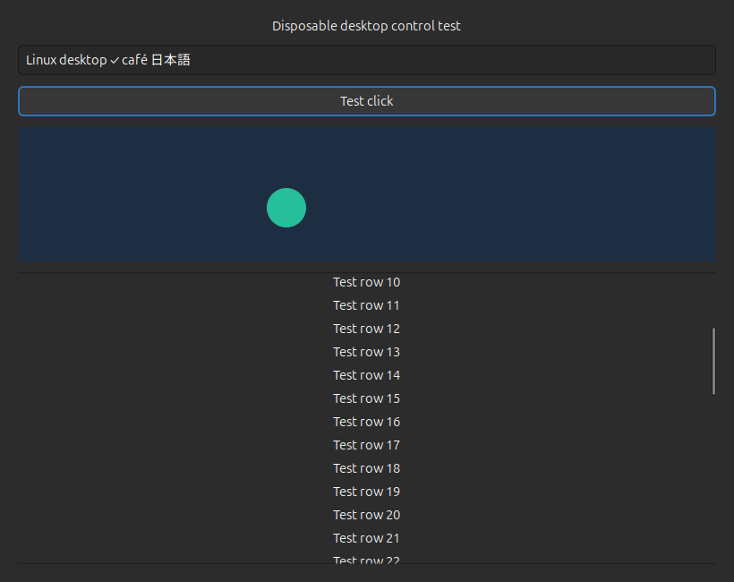

# Linux Desktop Control

Let Codex see and control apps on your Linux desktop through a local MCP server.
It can click, type, scroll, drag, and paste text, with a visible Stop button so
you can take back control.

**Beta 0.1.0b1:** tested on **Ubuntu GNOME, X11, and Python 3.12**.
**Wayland is not supported.** Other setups and MCP clients are unverified.
This is an independent project, available under the [MIT license](LICENSE).



## Get started

You need an unlocked Ubuntu GNOME desktop running X11. Check your session:

```sh
echo "$XDG_SESSION_TYPE"
```

It should print `x11`. XWayland inside a Wayland session is not enough.

On Ubuntu 24.04 with Python 3.12, install the prerequisites and register with Codex:

```sh
sudo apt-get update
sudo apt-get install python3-venv python3-gi gir1.2-gtk-3.0 libglib2.0-bin

git clone https://github.com/KingAkeem/linux-desktop-control.git
cd linux-desktop-control
./install --register
```

The installer downloads pinned dependencies into `.venv`. Registration adds an
MCP server, a skill link, and a marked section in `AGENTS.md` under `~/.codex`
(or `CODEX_HOME` if set). Review those changes, then reload MCP servers or
restart Codex. Keep the checkout in place while registered.

## Try it

Open an empty text editor and ask Codex:

> Use Linux Desktop Control to select the empty editor, type Hello Linux,
> capture the result, and stop.

Check the screenshot to confirm the result. This uses your current desktop
and shares your pointer and keyboard. Stay present while it runs.

**To stop:** move your mouse, press a key, click **Stop**, or use
**Ctrl+Alt+Escape**. Detection is reactive, so your first input may still reach
the app. A latched Stop needs a local **Resume permission** click before a new
task can start.

This is not an OS sandbox. Screenshots go to your MCP client, where its normal
data handling applies. Keep sensitive apps closed during initial testing.

## Troubleshooting and removal

Check dependencies and desktop readiness without starting control:

```sh
.venv/bin/linux-desktop-control doctor
```

To remove the client integration, stop any active task and run:

```sh
.venv/bin/linux-desktop-control uninstall
```

This removes the managed configuration, skill link, and guidance. Source files,
dependencies, logs, and Stop state stay in place. To install without changing
client configuration, use `./install` without `--register`.

## More details

- [Reference](docs/REFERENCE.md): setup details, the seven tools, input limits,
  clipboard behavior, and live checks.
- [Security and privacy](SECURITY.md): access boundaries and vulnerability reports.
- [Contributing](CONTRIBUTING.md): development checks and bug reports.
- [Verification](VERIFICATION.md) and [changelog](CHANGELOG.md).

Native Wayland, remote access, separate background desktops, and accessibility
element targeting are outside this beta's scope. It does not add Codex's
native `@Computer` interface.
